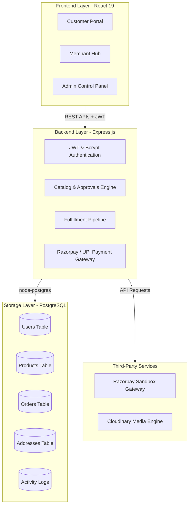
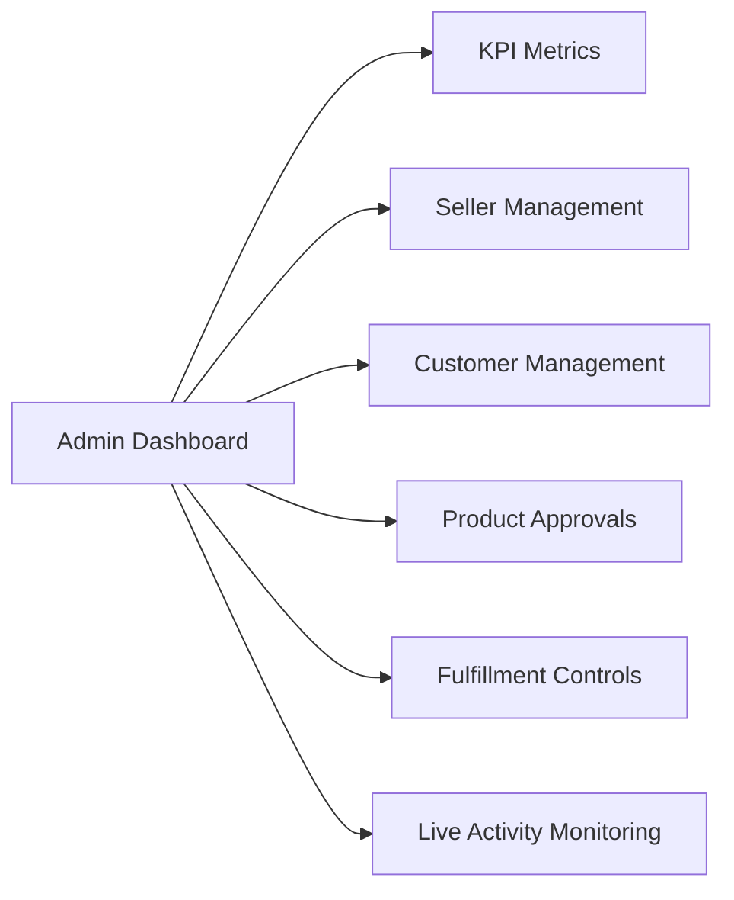
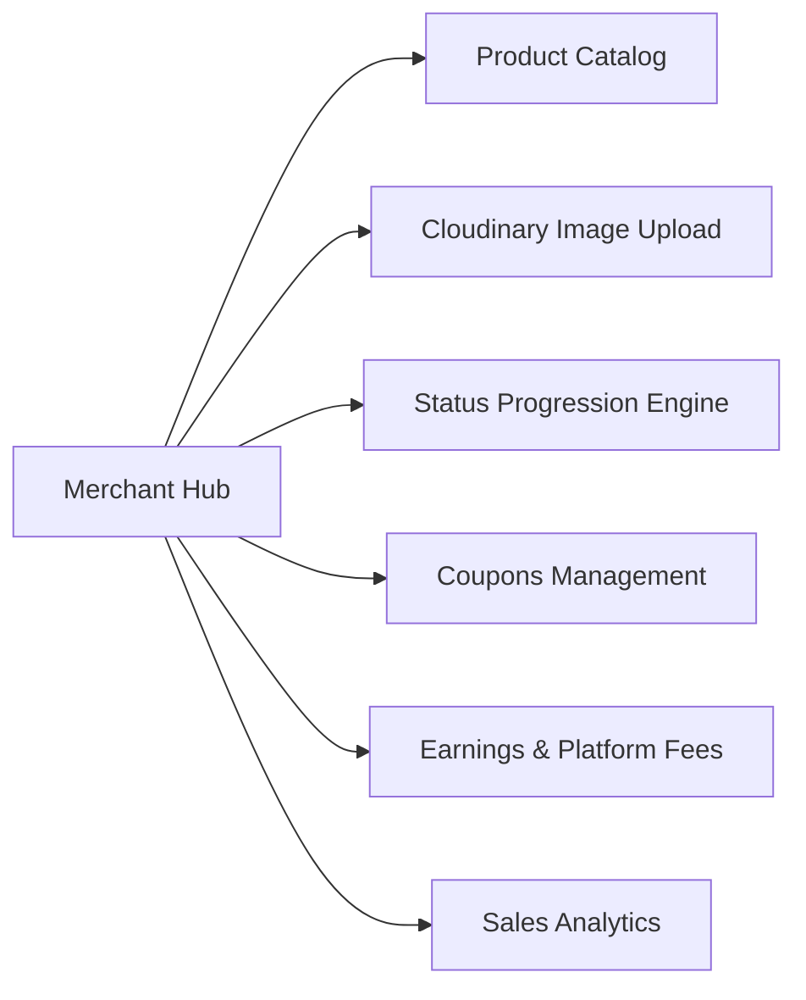
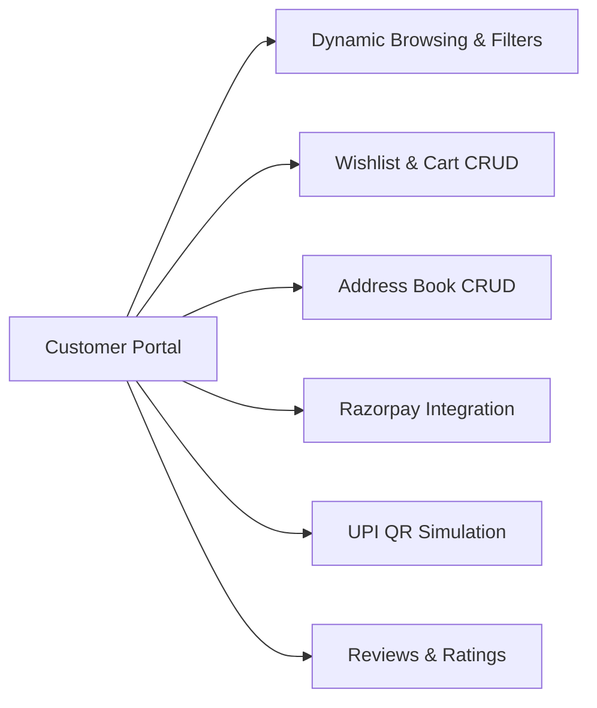

# 📊 NexaCart Dashboards Architecture & Tech Stack

This document provides a detailed breakdown of the technical stack, database entities, and feature portfolios across every role-based dashboard in the NexaCart E-Commerce platform.

---

## 🛠️ System-Wide Tech Stack

The NexaCart platform is built on an enterprise-grade full-stack architecture featuring a React frontend, Node.js + Express backend, and a PostgreSQL database.

### 1. Frontend Technologies
*   **Core Library**: **React v19.2.7** (utilizes functional components, state management hooks, and reference hooks).
*   **Routing**: **React Router DOM v7.18.1** (declarative routes, role authorization gates, parameters matching).
*   **Styling**: **Tailwind CSS v4.3.3 & PostCSS v8.5.19** (utility-first styles, customized responsive design grids, flexbox, glassmorphic effects, and `card-lift` animation components).
*   **Iconography**:
    *   `lucide-react v1.25.0` for vector-based clean layout icons.
    *   Google Fonts Material Symbols for Google-style system icons.
*   **HTTP Protocol**: Asynchronous Native `Fetch` API, wrapped with token injecting modules.

### 2. Backend Technologies
*   **Runtime Environment**: **Node.js (v18+)**
*   **Web Framework**: **Express.js v4.19.2** (handles request parsing, REST endpoints routing, CORS configurations, and custom middleware).
*   **Security & Hashing**:
    *   `jsonwebtoken v9.0.2`: Signs, issues, and validates JWT payloads containing user details (`id`, `name`, `email`, `role`).
    *   `bcryptjs v2.4.3`: Implements secure Blowfish-based password hashing for storage.
*   **Database Connector**: `pg` (node-postgres v8.11.5) with strict SQL parameterized inputs.

### 3. PostgreSQL Database Schema
*   **relational design** containing 9 connected entities:
    1.  `users`: Primary user profiles storing roles (`admin`, `seller`, `customer`), status flags (`is_blocked`), and seller credentials (`business_name`, `business_category`).
    2.  `products`: System catalogs storing details, specifications, seller mappings, stock level, status values (`pending`, `approved`, `rejected`, `deleted`), and media arrays.
    3.  `addresses`: Customers' multi-address checkout storage with `is_default` parameters.
    4.  `cart_items`: User-to-product join tables for shopping basket caching.
    5.  `wishlist_items`: User-to-product join tables for customer wishlists.
    6.  `orders`: Order records including customer details, product references, amounts, payment tracking, and status values (*Pending*, *Processing*, *Shipped*, *Delivered*, *Cancelled*, *Returned*).
    7.  `reviews`: Customer-authored reviews checking quality rating scores (1 to 5).
    8.  `notifications`: Targeted merchant & buyer alerts.
    9.  `activity_logs`: Event log storing system-wide actions for auditor insights.

### 4. External Integrations
*   **Razorpay SDK (v2.9.8)**: Generates secure checkout orders on the backend, opens the frontend Razorpay overlay, and processes secure payment callbacks with HMAC-SHA256 signature verification.
*   **Cloudinary SDK (v2.10.0)**: Processes Base64 buffer buffers, sending products' pictures directly to optimized cloud media repositories.

---

## 🖥️ 1. Admin Control Panel

### Role Overview
Admins govern the marketplace. They have privileges to review new seller products, manage seller and customer status, inspect transaction histories, and analyze system analytics.

### File Structure Map
*   **Portal Entrance**: [Portal.jsx](file:///d:/NexaCart/src/pages/Portal.jsx)
*   **Auth Pages**: [AdminLogin.jsx](file:///d:/NexaCart/src/pages/admin/AdminLogin.jsx) | [AdminSignup.jsx](file:///d:/NexaCart/src/pages/admin/AdminSignup.jsx)
*   **Dashboard Entry**: [AdminDashboard.jsx](file:///d:/NexaCart/src/pages/admin/AdminDashboard.jsx)
*   **Feature Modules**:
    *   [AdminProducts.jsx](file:///d:/NexaCart/src/pages/admin/AdminProducts.jsx)
    *   [AdminSellers.jsx](file:///d:/NexaCart/src/pages/admin/AdminSellers.jsx)
    *   [AdminCustomers.jsx](file:///d:/NexaCart/src/pages/admin/AdminCustomers.jsx)
    *   [AdminOrders.jsx](file:///d:/NexaCart/src/pages/admin/AdminOrders.jsx)
    *   [AdminProfile.jsx](file:///d:/NexaCart/src/pages/admin/AdminProfile.jsx)
    *   [AdminSettings.jsx](file:///d:/NexaCart/src/pages/admin/AdminSettings.jsx)
*   **Admin Components**: [Header.jsx](file:///d:/NexaCart/src/components/Header.jsx) | [Sidebar.jsx](file:///d:/NexaCart/src/components/Sidebar.jsx)

### Feature Portfolio & Capabilities

1.  **Marketplace Overview (KPI Stats Grid)**:
    *   Displays real-time KPIs: *Total Customers*, *Total Sellers*, *Total Orders*, and *Total Revenue*.
    *   *Total Revenue* is dynamically updated by summing order amounts, delivery charges, and platform fees across all recorded sales.
2.  **Interactive Revenue Analytics**:
    *   Visual bar chart indicating monthly revenue from February through July.
    *   Computes transaction distribution and scales heights dynamically based on actual database sales.
3.  **Real-Time Activity Logs**:
    *   Automatically pulls recent activity records from the database every 5 seconds.
    *   Monitors and logs details like "User Logged In", "Product Approved", or "Order Placed".
4.  **Sellers Moderation & Verification**:
    *   Table listing business names, owner details, contact information, and account status.
    *   Allows immediate blocking or unblocking of any merchant.
    *   Opens modal showing the merchant's catalog to inspect individual products.
5.  **Product Approval Queue**:
    *   Lists new products pending marketplace listing.
    *   Admins approve products to make them visible to customers, or reject them.
6.  **Customer Management & Order Adjustments**:
    *   Aggregates active customers and estimates Customer Lifetime Value (CLV).
    *   Enables blocking or unblocking customer accounts.
    *   Includes a modal with the customer's order history, allowing the admin to change order fulfillment statuses (e.g. from Pending to Delivered/Shipped).
7.  **Order Registry & Global Settings**:
    *   Allows system-wide management of global configurations like tax rates or shipping charge parameters.

### Tech Stack Details
*   **State Hooks**: Manages dashboard listings, charts scaling ratios, and active modals (`orders`, `products`, `orderDetail`).
*   **Effect Hooks**: Orchestrates a 5-second polling routine to fetch fresh logs, orders, and stats.
*   **Database Interactions**: Reads from `users`, `products`, `orders`, `activity_logs`. Updates block flags in `users`, status in `products`, and status in `orders`.
*   **API Enpoints Used**:
    *   `GET /api/products` (loads catalog stats)
    *   `GET /api/orders` (calculates revenues & recent sales)
    *   `GET /api/logs` (retrieves system audits)
    *   `GET /api/admin/users` (loads user accounts)
    *   `PUT /api/admin/users/:id/block` (blocks/unblocks users)
    *   `POST /api/products/:id/approve` (approves product status)
    *   `POST /api/products/:id/reject` (rejects/deletes product)

---

## 🏬 2. Merchant Hub (Seller Dashboard)

### Role Overview
Sellers use the Merchant Hub to list and configure products, monitor their catalog approval statuses, process orders, issue discount coupons, and track financial earnings or payouts.

### File Structure Map
*   **Auth Pages**: [SellerLogin.jsx](file:///d:/NexaCart/src/pages/seller/SellerLogin.jsx) | [SellerSignup.jsx](file:///d:/NexaCart/src/pages/seller/SellerSignup.jsx)
*   **Dashboard Entry**: [SellerDashboard.jsx](file:///d:/NexaCart/src/pages/seller/SellerDashboard.jsx)
*   **Feature Modules**:
    *   [SellerProducts.jsx](file:///d:/NexaCart/src/pages/seller/SellerProducts.jsx)
    *   [SellerProcessingOrders.jsx](file:///d:/NexaCart/src/pages/seller/SellerProcessingOrders.jsx)
    *   [SellerCancelledOrders.jsx](file:///d:/NexaCart/src/pages/seller/SellerCancelledOrders.jsx)
    *   [SellerReturns.jsx](file:///d:/NexaCart/src/pages/seller/SellerReturns.jsx)
    *   [SellerCoupons.jsx](file:///d:/NexaCart/src/pages/seller/SellerCoupons.jsx)
    *   [SellerAnalytics.jsx](file:///d:/NexaCart/src/pages/seller/SellerAnalytics.jsx)
    *   [SellerFinance.jsx](file:///d:/NexaCart/src/pages/seller/SellerFinance.jsx)
    *   [SellerSettings.jsx](file:///d:/NexaCart/src/pages/seller/SellerSettings.jsx)
    *   [SellerProfile.jsx](file:///d:/NexaCart/src/pages/seller/SellerProfile.jsx)
*   **Seller Components**: [SellerHeader.jsx](file:///d:/NexaCart/src/components/SellerHeader.jsx) | [SellerSidebar.jsx](file:///d:/NexaCart/src/components/SellerSidebar.jsx)

### Feature Portfolio & Capabilities

1.  **Merchant Performance KPIs**:
    *   Metrics: *Total Products*, *Active Orders*, *Total Revenue*, and *Store Ratings* (calculated from reviews).
    *   Includes month-over-month percentage growth badges with directional trend icons.
2.  **Product Management & Catalog Flow**:
    *   Shows approval statuses (*Approved*, *Pending*, *Rejected*).
    *   Allows creating listings with form fields: title, category, description, base price, discount %, stock, and return policy.
    *   Uploads up to 4 images to Cloudinary via a Base64 upload buffer.
    *   Mandates primary details and calculates the final discounted price in real-time.
3.  **Fulfillment Management**:
    *   Enables progressing orders containing the seller's products through states: *Pending*, *Processing*, *Shipped*, *Delivered*.
    *   Separate tab tracking cancelled items and returns/refunds.
4.  **Coupon Engine**:
    *   Sellers can create promotional coupons (e.g. flat discount or percentage-based) with custom expiry dates and usage limits.
    *   Displays real-time usage stats and progress meters.
5.  **Financial Ledger**:
    *   Differentiates earnings:
        *   *Total Earnings*: Total revenue of all orders marked as *Delivered* (includes item price + 50% shipping fee split).
        *   *Pending Payout*: Revenue from active orders that are not yet *Delivered*.
        *   *Available Balance*: Delivered orders revenue minus the 5% NexaCart platform fee.
    *   Visualizes earnings against platform fee breakdowns.

### Tech Stack Details
*   **State Management**: Complex form bindings, image upload arrays, financial charts, and pagination values.
*   **File Uploader**: Integrates an `input[type="file"]` bound to a `FileReader` instance to convert local files into Base64 encoding.
*   **Growth Calculus**: Calculates growth dynamically by comparing sales from the last 30 days against the preceding 30-day block.
*   **Database Tables**: Reads from `users`, `products`, `orders`, `reviews`. Inserts into `products`. Updates `products` (for pricing or edits) and `orders` (for status changes).
*   **API Endpoints Used**:
    *   `GET /api/products` (retrieves merchant-owned listings)
    *   `POST /api/products` (creates new product entry with Cloudinary media buffers)
    *   `GET /api/orders` (tracks sales pipeline)
    *   `PUT /api/orders/:id/status` (updates order fulfillment status)
    *   `GET /api/reviews` (aggregates feedback scores)

---

## 🛒 3. Premium Customer Portal

### Role Overview
The Customer Portal provides a shopping experience, letting users browse products, add items to a cart or wishlist, manage delivery addresses, and complete orders.

### File Structure Map
*   **Auth Pages**: [CustomerLogin.jsx](file:///d:/NexaCart/src/pages/customer/CustomerLogin.jsx) | [CustomerSignup.jsx](file:///d:/NexaCart/src/pages/customer/CustomerSignup.jsx)
*   **Main Hub**: [CustomerDashboard.jsx](file:///d:/NexaCart/src/pages/customer/CustomerDashboard.jsx)
*   **Catalog Pages**:
    *   [ProductDetail.jsx](file:///d:/NexaCart/src/pages/customer/ProductDetail.jsx)
    *   [ProductSearch.jsx](file:///d:/NexaCart/src/pages/customer/ProductSearch.jsx)
    *   [BrowseCategories.jsx](file:///d:/NexaCart/src/pages/customer/BrowseCategories.jsx)
*   **Checkout & Carts**:
    *   [ShoppingCart.jsx](file:///d:/NexaCart/src/pages/customer/ShoppingCart.jsx)
    *   [MyWishlist.jsx](file:///d:/NexaCart/src/pages/customer/MyWishlist.jsx)
*   **Orders Pages**:
    *   [MyOrders.jsx](file:///d:/NexaCart/src/pages/customer/MyOrders.jsx)
    *   [OrderDetails.jsx](file:///d:/NexaCart/src/pages/customer/OrderDetails.jsx)
*   **Settings Pages**: [UserProfile.jsx](file:///d:/NexaCart/src/pages/customer/UserProfile.jsx)
*   **Customer Components**: [CustomerHeader.jsx](file:///d:/NexaCart/src/components/CustomerHeader.jsx) | [CustomerFooter.jsx](file:///d:/NexaCart/src/components/CustomerFooter.jsx)

### Feature Portfolio & Capabilities

1.  **Catalog Discovery**:
    *   Browsing filters for categories (Electronics, Home Goods, Beauty) with dynamic page load animations.
    *   Search and sort capabilities (price, rating, discounts).
2.  **Product Page & Multi-Image Gallery**:
    *   Displays full specifications, highlights, warranty information, and a thumbnail gallery.
    *   Enables rating products and submitting reviews.
3.  **Wishlist & Cart**:
    *   Add to wishlist or cart with immediate status updates.
    *   Validates stock status to prevent purchasing out-of-stock items.
4.  **Delivery Address CRUD**:
    *   Allows saving multiple addresses with a default selection option.
5.  **Payment Integrations**:
    *   *Razorpay Gateway*: Triggers standard payment overlays with card, net banking, or wallet support. Verifies signatures on the backend.
    *   *UPI Scan & Pay*: Simulates a QR code payment with a 30-second countdown and mock verification callback.

### Tech Stack Details
*   **Aesthetic Enhancements**: Implements an `IntersectionObserver` on catalog cards to trigger fade-up animation entries as the user scrolls.
*   **Payment Signature Webhook**: Communicates with Razorpay JS SDK script injected in header. Triggers standard verify requests on backend payload signature matching algorithms.
*   **Database Tables**: Reads from `products`, `cart_items`, `wishlist_items`, `addresses`, `orders`, `reviews`. Inserts into `cart_items`, `wishlist_items`, `addresses`, `orders`, `reviews`.
*   **API Endpoints Used**:
    *   `GET /api/products` & `GET /api/products/:id` (retrieves approved products)
    *   `GET /api/cart` & `POST /api/cart` (reads and modifies active shopping basket)
    *   `PUT /api/cart/:productId` (adjusts item quantity)
    *   `DELETE /api/cart/:productId` (removes item from cart)
    *   `GET /api/addresses` & `POST /api/addresses` (manages shipping options)
    *   `POST /api/payments/order` (creates Razorpay checkout instance)
    *   `POST /api/payments/verify` (validates payment signatures)

---

## ⚡ Core Transactional & Administrative Flows

### A. Product Approval Lifecycle
1.  **Seller Submission**: A merchant uploads a product via [SellerProducts.jsx](file:///d:/NexaCart/src/pages/seller/SellerProducts.jsx). Images are converted to Base64 and sent to the backend.
2.  **Media Upload**: The backend uploads the images to Cloudinary, stores the resulting secure URLs, and writes the product record to the database with a status of `pending`.
3.  **Admin Review**: The product appears in the admin's approval queue. The admin reviews and either approves or rejects/deletes the item.
4.  **Notification & Listing**: The backend updates the product status to `approved`, creates a notification for the seller, and adds the item to the customer catalog.

### B. Checkout and Razorpay Integration Flow
1.  **Address & Payment Selection**: The customer selects a saved delivery address in the checkout tab and clicks the checkout button.
2.  **Order Initiation**: The backend creates an order record in the database and requests a payment transaction from Razorpay, returning the Razorpay Order ID.
3.  **Customer Payment**: The Razorpay payment form opens in the browser. The customer enters details to complete the transaction.
4.  **Signature Verification**: The frontend sends the Razorpay payment credentials back to the server. The server verifies the signature, marks the database order as `paid`, and clears the customer's cart.
